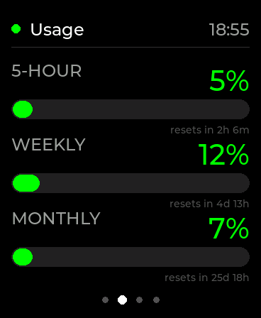
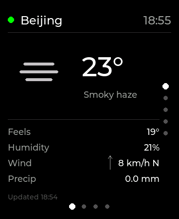
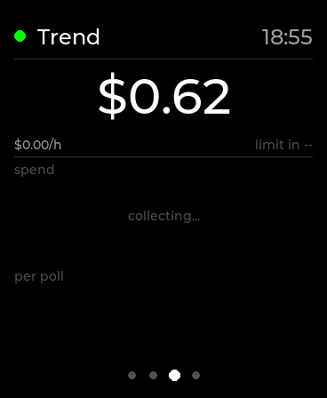
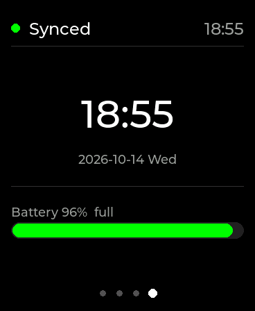
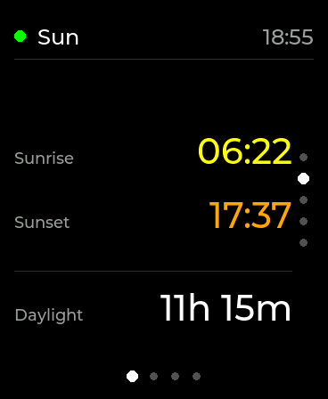
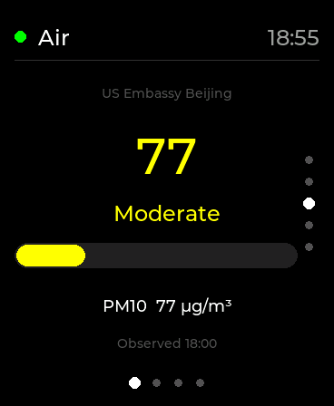
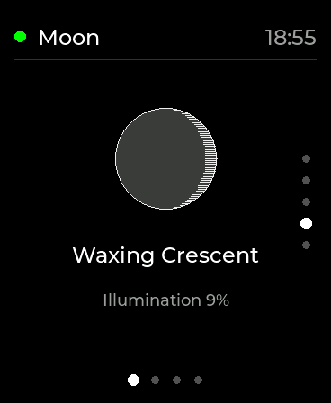
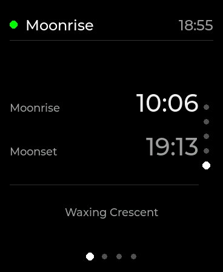

# ESP32-S3 Usage Monitor

A desk display for [OpenCode](https://opencode.ai) usage on a Waveshare
ESP32-S3-Touch-AMOLED-2.16: your rolling token spend, a trend view, the weather
and a clock — and the panel reacts while the agent is working.

<p align="center">
  
</p>

Four pages (Weather · Usage · Trend · Clock) driven by touch, twist or key, five
weather cards, an OpenCode status bridge with chimes, and a Trend page that plots
spend rate and time-to-limit.

## Screens

<p align="center">
  
  
  
  
  <br>
  <sub><b>Weather</b> (Now card) &nbsp;·&nbsp; <b>Usage</b> &nbsp;·&nbsp; <b>Trend</b> &nbsp;·&nbsp; <b>Clock</b></sub>
</p>

The Weather page holds five vertical cards — swipe up/down to move between them:

<p align="center">
  
  
  
  
  <br>
  <sub><b>Sun</b> &nbsp;·&nbsp; <b>Air</b> &nbsp;·&nbsp; <b>Moon</b> &nbsp;·&nbsp; <b>Moonrise</b></sub>
</p>

The bottom dot row marks the current page and the right-hand dot column the
current weather card. These are real captures from the device — see
[Notes](#notes) for how to regenerate them.

## Features

- **Four horizontal pages** — Weather ↔ Usage ↔ Trend ↔ Clock: swipe, tap, twist
  the device, or press Key1.
- **Five weather cards** — Now → Sun → Air → Moon → Moonrise/Moonset.
- **Usage meters** — 5-hour rolling / weekly / monthly, each with a reset
  countdown; the bars go green, yellow above 30% and red above 60%.
- **Trend page** — 5-hour rolling spend, `$/h` burn rate, estimated time to
  limit, plus a cumulative spend curve and per-poll bars. The history ring is
  RAM-only, so it starts empty on every boot and fills as polls land.
- **Status bridge** — an OpenCode plugin drives the device over HTTP: a
  "Thinking…" animation while the agent works, "Needs you" plus an attention
  chime when it asks for permission, and rising / falling chimes when a session
  succeeds or fails.
- **Chimes** are synthesised at boot on the ES8311 codec — nothing to upload. The
  555 easter egg (`data/555_audio.raw`) is the only audio file.
- **IMU gestures** (QMI8658) — shake plays the 555 easter egg, double-tap
  advances, twist left/right steps pages or cards, lifting the device wakes it
  and face-down blanks the panel.
- **OAuth device flow** — authorise once with `tools/authorize.py`; the refresh
  token rotates automatically and is persisted to LittleFS.
- **WiFi setup UI** on first boot — scan, pick a network, type the password with
  the touch keyboard or the two keys.
- **Glanceable power** — 30 s without input dims the panel to 50/255 and any
  touch, key or status event wakes it. It only ever blanks while the device is
  face-down, and a frame is re-rendered and pushed only when something on it
  actually changes.

## Hardware

- **Board**: Waveshare ESP32-S3-Touch-AMOLED-2.16 — ESP32-S3, 8 MB PSRAM,
  16 MB flash (an 8 MB partition table: two 3 MB OTA app slots + ~2 MB LittleFS)
- **Display**: 480×480 rounded-square AMOLED (CO5300, QSPI). The UI is authored
  on a 184×224 logical grid, rasterised at 2× and blitted as a 368×448 canvas
  centred in the panel
- **Touch**: CST9220 · **IMU**: QMI8658 · **RTC**: PCF85063 · **PMU**: AXP2101
- **Audio**: ES8311 codec + PA (chimes and the easter egg)
- **Keys**: Key1 (middle, PWR), Key2 (left, IO18), BOOT (right)

The current build targets the 2.16 board (`-DBOARD_WAVESHARE_ESP32S3_TOUCH_AMOLED_2_16`
in `platformio.ini`); pin maps for the ESP32-S3 AMOLED 1.8 and 1.75c and the
ESP32-C6 AMOLED 2.16 live in `src/boards/`, though only the 2.16 is wired into
the build today.

## Quick start

1. Install [PlatformIO](https://platformio.org/) and clone the repository:

   ```bash
   git clone https://github.com/2700zc/esp32-usage-monitor.git
   cd esp32-usage-monitor
   ```

2. Create your config and fill in `workspace_id`:

   ```bash
   cp data/config.json.example data/config.json
   ```

3. Authorise the device (OAuth device flow) and flash it:

   ```bash
   python3 tools/authorize.py
   pio run -e esp32-usage-monitor -t upload -t uploadfs
   ```

4. On first boot the device opens the WiFi setup UI; after that it goes straight
   to the desktop and syncs the clock over NTP.

### Configuration

`data/config.json` (gitignored — it holds credentials):

```json
{
  "workspace_id": "wrk_XXXXXXXXXXXXXXXXXXXXXXXX",
  "refresh_token": "",
  "org_id": "",
  "waqi_token": "",
  "status_key": "",

  "poll_usage_s": 60,
  "poll_usage_idle_s": 180,
  "poll_weather_s": 1800,
  "poll_air_s": 3600,
  "poll_moon_s": 43200,

  "chime": true,
  "imu_gestures": true
}
```

| Field | Default | Description |
|---|---|---|
| `workspace_id` | — | **Required.** Your workspace / org id (starts with `wrk_`) |
| `refresh_token` | — | Written by `tools/authorize.py`; do not fill in by hand |
| `org_id` | — | Written by the authoriser; falls back to `workspace_id` when empty |
| `waqi_token` | — | Optional [aqicn.org](https://aqicn.org/data-platform/token/) token; enables the Air card |
| `status_key` | — | Shared secret for the status endpoint (HMAC-SHA256). **Empty disables its auth** |
| `poll_usage_s` | `60` | Usage poll period (seconds) |
| `poll_usage_idle_s` | `180` | Usage poll period while the device has been untouched for 30 s |
| `poll_weather_s` | `1800` | Weather poll period |
| `poll_air_s` | `3600` | Air-quality poll period |
| `poll_moon_s` | `43200` | Moon poll period |
| `chime` | `true` | Play a chime when the agent finishes or needs you |
| `imu_gestures` | `true` | Shake / double-tap / pickup / face-down / twist |

### Authorisation (OAuth device flow)

```bash
python3 tools/authorize.py          # open the printed URL, sign in, confirm the code
python3 tools/authorize.py --check  # refresh and print the current usage (device must be off)
```

The script writes `refresh_token` / `org_id` back into `data/config.json`.

> **⚠️ Token lifecycle**
> The refresh token is **single-use** and rotates on every refresh; reusing an old
> one revokes the whole token family (and you must re-authorise). After the first
> boot the device takes ownership and saves the rotated token to LittleFS
> `/tokens.json`.
>
> - `pio run -t upload` (firmware only) is **safe** — it does not touch the filesystem.
> - `pio run -t uploadfs` **erases** LittleFS (including `/tokens.json`), so the device
>   falls back to the possibly stale token in `config.json`. **Always run
>   `python3 tools/authorize.py` right before an `uploadfs`.**
> - Do **not** run `python3 tools/authorize.py --check` while the device is live — it
>   rotates the token and invalidates the device's copy.

## Build & upload

```bash
# compile
pio run -e esp32-usage-monitor

# upload firmware
pio run -e esp32-usage-monitor -t upload

# upload filesystem (config.json, easter-egg assets)
pio run -e esp32-usage-monitor -t uploadfs

# upload both
pio run -e esp32-usage-monitor -t upload -t uploadfs
```

### macOS arm64 note

PlatformIO's `tool-mklittlefs` package ships an x86_64-only binary, so `uploadfs`
fails with `mklittlefs: Bad CPU type in executable`. Download the
`aarch64-apple-darwin-*.tar.gz` asset from
<https://github.com/jason2866/mklittlefs/releases> and replace
`~/.platformio/packages/tool-mklittlefs@3.2.0/mklittlefs`.

## Using it

- **WiFi setup (first boot).** The device scans and lists networks; tap one to
  select it, or use the keys. With saved credentials it first gives the connect a
  30 s grace period — tap or press a key to skip straight to the network list.
  - **Key1 (middle)**: short press cycles the character, long press (600 ms)
    switches the character group (`abc` / `ABC` / `123` / symbols)
  - **Key2 (left)**: short press types the character, long press (800 ms)
    connects
  - The on-screen touch keyboard does the same thing directly
- **Pages.** Swipe left/right (or tap) to move between Weather / Usage / Trend /
  Clock. On the Weather page, swipe up/down for the five cards. Twisting the
  device left or right steps one page or card, and a double-tap advances.
- **Key1** cycles pages, and dismisses the "Thinking…" / "Needs you" animation.
- **Shake** plays the 555 easter egg; **lifting** the device wakes the panel;
  **face-down** blanks it until you pick it up.
- **Power key**: hold ~4 s to shut down.

## Status bridge (OpenCode → device)

The device runs a small HTTP server on port 80 (advertised over mDNS as
`usage-monitor.local`); `tools/opencode-plugin/` is its client and pushes the
agent's state:

| OpenCode V2 event | Request | Device |
|---|---|---|
| `session.execution.started` | `?state=running` | "Thinking…" animation, wakes the panel |
| `permission.asked` | `?state=waiting` | "Needs you" animation + attention chime |
| `session.execution.succeeded` / `interrupted` | `?state=done` | rising chime |
| `session.execution.failed` | `?state=failed` | falling chime |

Every request is signed with `HMAC-SHA256(status_key, "<state>|<unixSeconds>")`
in `X-Sig` / `X-Ts`; a bad or missing signature gets `401` and changes nothing,
and a ±60 s window blocks replays. See
[`tools/opencode-plugin/README.md`](tools/opencode-plugin/README.md) for setup,
and `tools/status-ping.sh` to drive the endpoint by hand.

## Project layout

```
├── data/
│   ├── config.json          # runtime config (gitignored)
│   ├── config.json.example  # config template
│   ├── 555_audio.raw        # easter-egg audio
│   └── 555.raw              # easter-egg artwork
├── src/
│   ├── main.cpp             # setup/loop, poll schedule, render + push
│   ├── ui_compose.cpp/h     # picks the page/cards to draw for the pager state
│   ├── ui_model.h           # neutral UiPage / UiWeatherCard enums + UiEnv
│   ├── pager.cpp/h          # page/card gesture + animation state machine
│   ├── status_server.cpp/h  # HTTP status endpoint (signed state changes)
│   ├── clock_sync.cpp/h     # NTP bootstrap + RTC resync scheduling
│   ├── gestures.cpp/h       # IMU sampling (shake / tap / pickup / face-down)
│   ├── easter_egg.cpp/h     # 555 playback
│   ├── usage_history.cpp/h  # RAM ring of spend samples (Trend page)
│   ├── storage.cpp/h        # LittleFS mount helper
│   ├── config.h             # AppConfig + LittleFS JSON loader
│   ├── token_store.cpp/h    # OAuth tokens persisted to LittleFS
│   ├── http_client.cpp/h    # shared blocking HTTPS helper
│   ├── fetch_task.cpp/h     # background fetch worker (job/result queues)
│   ├── api_client.cpp       # OpenCode console REST client
│   ├── weather_client.cpp/h # weather / moon / air quality
│   ├── wifi_setup.cpp/h     # WiFi setup UI
│   ├── frame_dump.cpp/h     # -DFRAME_DUMP screen walker (screenshot tool)
│   ├── diag.cpp/h           # boot/fetch freeze diagnostics
│   ├── usage_display.h      # public UI drawing API
│   ├── ui/                  # cards, trend, primitives, icons, lvgl_text, theme
│   │   └── fonts/           # own Montserrat builds (lv_font_ui_*.c)
│   ├── parse/               # header-only payload parsers (usage/weather/moon/air)
│   ├── util/                # dependency-free helpers (host-unit-tested)
│   ├── voice/               # I2S audio (ES8311, chimes)
│   ├── boards/              # per-board pin definitions
│   └── hw/                  # display, input, power, imu, rtc, expander, net
├── test/test_util/          # host unit tests (pio test -e native)
├── tools/                   # PC-side scripts + the OpenCode plugin
└── platformio.ini           # PlatformIO config
```

## Tests

The pure helpers under `src/util/` (epoch/date parsing, weather-icon kind, moon
phase, AQI label, gesture classifier, trend math, `Interval`) and the header-only
parsers under `src/parse/` (usage meters, wttr one-line, moon/air JSON) are free
of Arduino dependencies and covered by host unit tests — no hardware needed:

```bash
pio test -e native
```

CI runs that plus `pio run -e esp32-usage-monitor` on every push and PR.

## Notes

- `data/config.json` holds credentials and is gitignored; never commit it. After
  editing it, re-upload the filesystem (`-t uploadfs`).
- The screenshots above come from the device itself. Build with
  `PLATFORMIO_BUILD_FLAGS='-DFRAME_DUMP' pio run -e esp32-usage-monitor -t upload`,
  then `python3 tools/frame_dump.py /dev/cu.usbmodemXXXX docs/screens` walks the
  pages and rebuilds each raw RGB565 frame as a PNG.
- Sources: weather from [wttr.in](https://wttr.in/Beijing) (Beijing), moon data
  from MET Norway, air quality from [waqi](https://aqicn.org) (@3303, US Embassy
  Beijing).
- The design notes — token lifecycle, the fetch worker, display power, TLS trust
  anchors, text rendering — live in [`AGENTS.md`](AGENTS.md); the change history
  is in [`CHANGELOG.md`](CHANGELOG.md).

## Related

- A Windows floating usage widget: <https://github.com/2700zc/TokenHub> — ready to
  use once configured

## License

MIT
